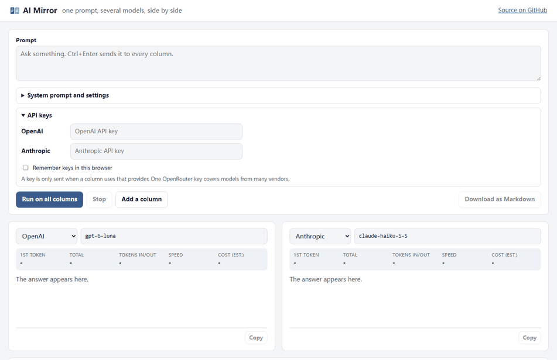

# AI Mirror

Send one prompt to two or three LLMs side by side and compare their answers, latency, token counts and estimated cost.



*The GIF was recorded locally with `MOCK_UPSTREAM=1`, so the replies, timings and token counts in it are canned by [`scripts/mock-upstream.mjs`](scripts/mock-upstream.mjs) and say nothing about the real models. With real keys the columns show real answers.*

**Live:** https://ai-mirror-dusky.vercel.app (bring your own API keys)

## Why I built it

When I pick a model for a project I want to see the same prompt answered by a cheap model and a stronger one, and know what each answer cost and how long it took. Provider playgrounds only show their own models, and switching tabs makes it hard to compare. This page puts the answers next to each other with the numbers underneath.

An earlier version of this repo was a chat app that restyled itself to look like each vendor's product and was pitched as "free AI for users in mainland China" with relay suggestions. I dropped all of that: copying other companies' branding is not mine to do, and the "free" pitch was misleading, since every provider here needs a key and someone pays for every call.

## What it does

- Pick two or three columns, each with a provider and model. Providers: OpenAI, Anthropic, Google Gemini, DeepSeek, Mistral and OpenRouter (one OpenRouter key reaches Qwen, GLM, Kimi, gpt-oss and many others). The model field is free text, so any model id the provider accepts works.
- Write a prompt (and optionally a system prompt, temperature and max output tokens) and press **Run on all columns** or Ctrl+Enter. All columns stream at the same time.
- Under each column: time to first token, total time, input and output tokens, output speed, and an estimated cost from a small [price table](public/js/prices.js) with the date it was checked. Token counts come from the provider when it reports them; otherwise they are estimated from text length and marked with "~".
- Streamed reasoning, when a provider sends it, is kept in a collapsed "Reasoning" box.
- **Download as Markdown** saves the prompt, a stats table and every answer.

## Run it locally

Node 20 or newer, no dependencies to install.

```bash
git clone https://github.com/appleweiping/ai-mirror.git
cd ai-mirror
npm run dev      # http://localhost:3000
npm test
```

Without keys, `MOCK_UPSTREAM=1 npm run dev` (PowerShell: `$env:MOCK_UPSTREAM=1; npm run dev`) answers every request with canned text so you can click through the page; type anything as the key.

To deploy your own copy, import the repo on Vercel. No build step or environment variables are needed.

## Where your prompt and keys go

- The page sends each column's request, with that provider's key in an `X-User-Key` header, to the site's `/api/chat` edge function. The function forwards it to the provider and streams the answer back. Its code does not log or store prompts or keys; Vercel keeps its normal request logs (path, status, time).
- Keys stay in the tab's `sessionStorage` unless you tick *Remember keys*, which moves them to `localStorage` in that browser.
- `/api/chat` only answers pages from its own host (it checks the `Origin` header), so other sites cannot use a deployment as a relay from their visitors' browsers. Server-side keys are ignored unless the operator sets `ALLOW_OPERATOR_KEYS=1`, and then requests are rate-limited per IP. See [`.env.example`](.env.example).
- Whatever you send is then covered by that provider's own data policy.

## Reading the numbers

Times are measured in the browser, so they include the round trip through the edge function and your own network. One run is one sample; run a prompt a few times before drawing conclusions about speed. Reasoning models spend hidden output tokens before the first visible token, which shows up as a long "1st token" time and a higher output count than the visible text suggests. Costs use list prices at the standard rate; batch, cached and off-peak pricing are not modelled, and Mistral has no price on file.

## Why not an existing tool?

[OpenRouter's chat room](https://openrouter.ai/chat) and [LMArena](https://lmarena.ai) already let you compare models side by side, and they have far more models. This is a small self-hostable page that uses your own keys directly with each provider, shows latency, token counts and cost next to each answer, and exports the comparison as a file.

## Shared code

The provider adapter (`api/_providers.js`, `api/chat.js`, `api/models.js`), the browser stream client (`public/js/stream-client.js`), the dev server and their tests are shared with my interview practice app [AceCue](https://github.com/appleweiping/acecue). Both repos keep identical copies; `npm run check:shared` compares them with the GitHub copy of the other repo.

## License

MIT, see [LICENSE](LICENSE).
